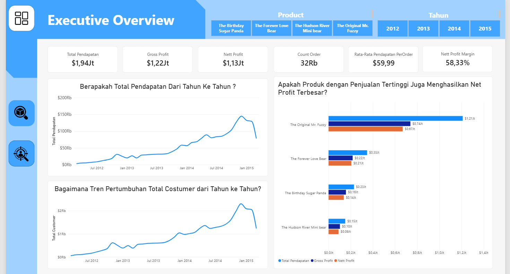
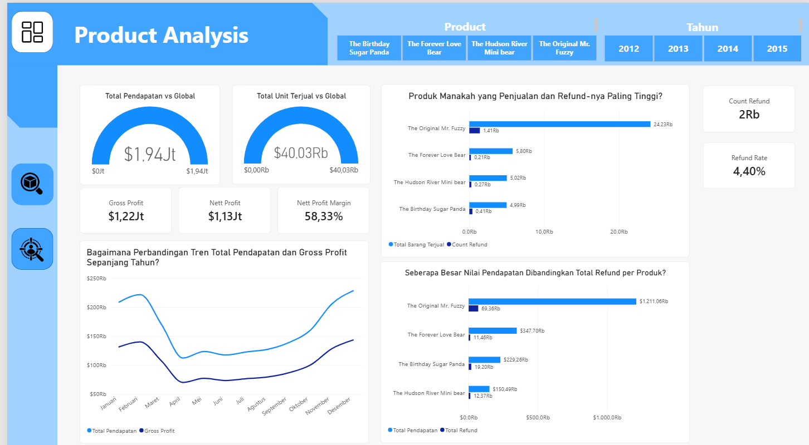
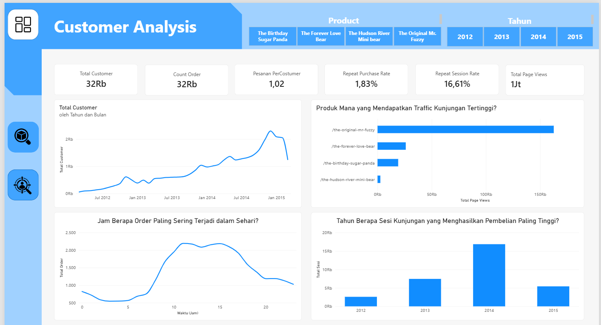

# 🧸 Toy Store Business Performance & Customer Analytics

Dashboard interaktif Microsoft Power BI untuk mengeksplorasi kinerja penjualan, profitabilitas produk, pengembalian dana (*refund*), serta perilaku pelanggan dan aktivitas pengunjung situs web.

https://github.com/user-attachments/assets/70243936-b13b-4c63-b7b0-2b8d6d0063a6

## Daftar Isi

- [Tentang Proyek](#tentang-proyek)
- [Pertanyaan Analisis](#pertanyaan-analisis)
- [Tools dan Keterampilan](#tools-dan-keterampilan)
- [Struktur Model Data](#struktur-model-data)
- [Perhitungan KPI](#perhitungan-kpi)
- [Hasil Analisis dan Insight](#hasil-analisis-dan-insight)
- [Kesimpulan dan Rekomendasi](#kesimpulan-dan-rekomendasi)

## Tentang Proyek

Proyek ini berfokus pada pembuatan dashboard interaktif menggunakan Microsoft Power BI untuk menganalisis kinerja bisnis toko mainan berdasarkan data pesanan, detail item pesanan, refund, sesi website, dan tampilan halaman (*page views*).

Dashboard menyajikan indikator kinerja utama (*Key Performance Indicators* atau KPI) serta visualisasi untuk membantu memahami perubahan pendapatan dan profit, membandingkan kinerja produk, mengevaluasi refund, serta melihat aktivitas pelanggan dan pengunjung situs web. Pengguna dapat mengeksplorasi data melalui filter produk dan tahun.

### 🎯 Tujuan Proyek

- Memantau kinerja pendapatan dan profit bisnis.
- Menganalisis tren pendapatan dan aktivitas pelanggan dari waktu ke waktu.
- Mengidentifikasi produk dengan kontribusi penjualan dan pendapatan terbesar.
- Membandingkan pendapatan, biaya pokok barang, gross profit, dan net profit.
- Mengevaluasi jumlah serta nilai refund berdasarkan produk.
- Memahami perilaku pembelian, sesi website, dan aktivitas page views.
- Menyajikan hasil analisis melalui dashboard interaktif untuk mendukung pengambilan keputusan berbasis data.

## Pertanyaan Analisis

🧩 Analisis disusun untuk menjawab enam pertanyaan bisnis berikut. Setiap pertanyaan dibahas kembali pada bagian hasil analisis agar temuan dan implikasi bisnisnya saling terhubung.

1. 💰 **Bagaimana perubahan pendapatan dan profit dari waktu ke waktu?**
2. 🧸 **Produk mana yang memberikan kontribusi pendapatan dan jumlah penjualan terbesar?**
3. 📈 **Bagaimana perbandingan pendapatan, gross profit, dan net profit setiap produk?**
4. ↩️ **Bagaimana jumlah dan nilai refund dibandingkan dengan penjualan setiap produk?**
5. 👥 **Bagaimana perkembangan pelanggan, pembelian, dan aktivitas sesi website?**
6. 🕒 **Pada jam berapa pesanan paling sering terjadi dan halaman produk mana yang paling banyak dilihat?**

> **Batasan interpretasi:** jumlah refund dan nilai refund merupakan dua metrik yang berbeda. Refund Rate pada dashboard dihitung sebagai nilai refund dibagi pendapatan, sehingga tidak menunjukkan persentase pesanan yang mengalami refund. Selain itu, jumlah sesi yang terkait dengan pesanan tidak otomatis sama dengan jumlah pesanan karena satu sesi dapat berkaitan dengan lebih dari satu catatan transaksi. Interpretasi profit juga mengikuti definisi yang digunakan dalam measure DAX proyek ini.

## Tools dan Keterampilan

- **Microsoft Power BI** — pembuatan dashboard, KPI, dan visualisasi data.
- **DAX (Data Analysis Expressions)** — pembuatan measure, agregasi, rasio, dan perhitungan indikator bisnis.
- **Pemodelan Data** — penggunaan tabel transaksi, detail pesanan, refund, sesi website, dan page views.
- **Data Visualization** — grafik garis, grafik batang, grafik kolom, kartu KPI, dan gauge.
- **Dashboard Interaktif** — penggunaan filter produk dan tahun untuk mengeksplorasi metrik.
- **Analisis Bisnis** — menerjemahkan pertanyaan bisnis menjadi metrik, visualisasi, insight, dan rekomendasi.

## Struktur Model Data

Analisis menggunakan beberapa tabel utama berikut berdasarkan kolom yang dipakai dalam measure DAX.

| Tabel | Fungsi dalam Analisis |
|---|---|
| `orders` | Menyimpan informasi pesanan, termasuk `order_id`, `user_id`, dan `website_session_id`. |
| `order_items` | Menyimpan detail item pesanan, termasuk `price_usd` dan `cogs_usd` untuk perhitungan pendapatan dan biaya pokok barang. |
| `order_item_refunds` | Menyimpan catatan refund dan nilai pengembalian dana melalui `refund_amount_usd`. |
| `website_sessions` | Menyimpan informasi sesi website, pengguna, dan penanda sesi berulang (`is_repeat_session`). |
| `website_pageviews` | Menyimpan catatan tampilan halaman melalui `website_pageview_id`. |


> Nama tabel dan kolom di atas mengikuti referensi yang digunakan pada measure DAX. Pastikan relasi antartabel di model Power BI aktif dan sesuai dengan kunci datanya agar filter produk dan tahun memengaruhi visualisasi secara konsisten.

## Perhitungan KPI

📌 KPI digunakan untuk memberikan ringkasan kinerja bisnis berdasarkan filter yang dipilih. Measure berikut mendokumentasikan perhitungan utama yang digunakan dalam dashboard.

### 💰 Total Pendapatan

```dax
Total Pendapatan =
SUM(order_items[price_usd])
```

Menjumlahkan nilai `price_usd` dari seluruh item pesanan dalam konteks filter yang aktif.

### 📦 Total COGS

```dax
Total COGS =
SUM(order_items[cogs_usd])
```

Menjumlahkan biaya pokok barang (*Cost of Goods Sold*) dari detail item pesanan.

### 📈 Gross Profit

```dax
Gross Profit =
[Total Pendapatan] - [Total COGS]
```

Menghitung selisih antara pendapatan dan biaya pokok barang.

### 🧾 Count Order

```dax
Count Order =
DISTINCTCOUNT(orders[order_id])
```

Menghitung jumlah pesanan unik berdasarkan `order_id`, bukan jumlah baris pada tabel transaksi.

### 🛒 Total Barang Terjual

```dax
Total Barang Terjual =
COUNTROWS(order_items)
```

Menghitung jumlah baris pada tabel `order_items`. Perhitungan ini merepresentasikan jumlah unit hanya apabila setiap baris pada tabel tersebut mewakili satu unit barang. Jika satu baris dapat memiliki beberapa unit, perhitungan perlu menggunakan kolom kuantitas.

### 💵 Rata-Rata Pendapatan per Pesanan

```dax
Rata-Rata Pendapatan PerOrder =
DIVIDE(
    [Total Pendapatan],
    [Count Order]
)
```

Menghitung rata-rata pendapatan untuk setiap pesanan.

### ↩️ Total Refund

```dax
Total Refund =
SUM(order_item_refunds[refund_amount_usd])
```

Menjumlahkan nilai refund yang tercatat pada tabel `order_item_refunds`.

### 🧮 Nett Profit

```dax
Nett Profit =
[Gross Profit] - [Total Refund]
```

Menghitung gross profit setelah dikurangi nilai refund yang tercatat. Interpretasi ini berlaku dengan asumsi refund belum dikurangkan sebelumnya dalam perhitungan pendapatan atau profit.

### 📊 Nett Profit Margin

```dax
Nett Profit Margin =
DIVIDE(
    [Nett Profit],
    [Total Pendapatan]
)
```

Mengukur rasio nett profit terhadap total pendapatan. Hasil diformat sebagai persentase.

### 👥 Total Customer

```dax
Total Customer =
DISTINCTCOUNT(orders[user_id])
```

Menghitung jumlah pengguna unik yang memiliki pesanan dalam konteks filter yang aktif. Metrik ini berbeda dari total pengunjung website.

### 🔁 Repeat Purchase

```dax
Repeat Purchase =
COUNTROWS(
    FILTER(
        VALUES(orders[user_id]),
        CALCULATE(
            DISTINCTCOUNT(orders[order_id])
        ) > 1
    )
)
```

Menghitung jumlah pelanggan yang memiliki lebih dari satu pesanan unik dalam konteks filter yang aktif.

### 🔄 Repeat Purchase Rate

```dax
Repeat Purchase Rate =
DIVIDE(
    [Repeat Purchase],
    [Total Customer],
    0
)
```

Mengukur proporsi pelanggan yang melakukan pembelian lebih dari satu kali terhadap seluruh pelanggan yang melakukan pembelian. Pembilang dan penyebut sama-sama menggunakan satuan pelanggan.

### 🧾 Pesanan per Customer

```dax
Pesanan PerCostumer =
DIVIDE(
    [Count Order],
    [Total Customer]
)
```

Mengukur rata-rata jumlah pesanan untuk setiap pelanggan yang melakukan transaksi.

### 🧮 Count Refund dan Refund Rate

```dax
Count Refund =
COUNTROWS(order_item_refunds)
```

```dax
Refund Rate =
DIVIDE(
    [Total Refund],
    [Total Pendapatan]
)
```

`Count Refund` menghitung jumlah baris refund, bukan otomatis jumlah pesanan unik yang mengalami refund. Sementara itu, `Refund Rate` mengukur rasio nilai refund terhadap pendapatan, bukan persentase pesanan yang di-refund.

### 🌐 Total Sessions dan Total Visitors

```dax
Total Sessions =
DISTINCTCOUNT(website_sessions[website_session_id])
```

```dax
Total Visitors =
DISTINCTCOUNT(website_sessions[user_id])
```

`Total Sessions` menghitung sesi website unik, sedangkan `Total Visitors` menghitung pengguna unik yang memiliki sesi dalam konteks filter aktif.

### 🔁 Repeat Sessions dan Repeat Session Rate

```dax
Repeat Sessions =
CALCULATE(
    DISTINCTCOUNT(website_sessions[website_session_id]),
    website_sessions[is_repeat_session] = 1
)
```

```dax
Repeat Session Rate =
DIVIDE(
    [Repeat Sessions],
    [Total Sessions]
)
```

Menghitung jumlah sesi yang ditandai sebagai sesi berulang dan proporsinya terhadap seluruh sesi dalam konteks filter.

### 🛍️ Sessions with Orders dan Conversion Rate

```dax
Sessions with Orders =
DISTINCTCOUNT(orders[website_session_id])
```

```dax
Conversion Rate =
DIVIDE(
    [Sessions with Orders],
    [Total Sessions]
)
```

Mengukur proporsi sesi website yang tercatat memiliki pesanan terhadap seluruh sesi website. Perhitungan ini memerlukan konsistensi `website_session_id` dan relasi data yang tepat.

### 👁️ Total Page Views

```dax
Total Page Views =
COUNTA(website_pageviews[website_pageview_id])
```

Menghitung jumlah ID page view yang tidak kosong pada tabel `website_pageviews`.

> **Catatan validasi:** `Total Pendapatan Universal` dan `Total Barang Terjual Universal` menggunakan `ALL(order_items)` untuk menghapus filter langsung pada tabel `order_items`. Filter dari tabel dimensi lain belum tentu ikut dihapus. Hasilnya perlu diperiksa terhadap model relasi dan slicer yang digunakan. Selain itu, pastikan nilai refund tidak dikurangkan dua kali dan setiap baris `order_items` memang mewakili satu unit sebelum menginterpretasikan hasil KPI.

## Hasil Analisis dan Insight

📊 Bagian berikut menjawab pertanyaan analisis berdasarkan visualisasi pada dashboard. Insight bersifat deskriptif dan dibatasi pada informasi yang terlihat di report. Angka yang tampil dengan satuan ribu atau juta perlu dipastikan kembali melalui format visual dan nilai measure sebelum dicantumkan sebagai angka final.

### 💰 1. Bagaimana perubahan pendapatan dan profit dari waktu ke waktu?

#### 📈 Executive Overview



**🔍 Temuan utama**

- Dashboard menampilkan ringkasan pendapatan, gross profit, net profit, rata-rata pendapatan per pesanan, jumlah pesanan, dan net profit margin.
- Grafik tren menunjukkan pendapatan meningkat pada sebagian besar rentang waktu yang ditampilkan, dengan kenaikan yang lebih tajam menjelang akhir 2014 dan awal 2015.
- Grafik pelanggan juga menunjukkan kecenderungan meningkat pada sebagian besar periode, meskipun terdapat penurunan pada titik akhir grafik.

**💡 Jadi, apa artinya?**

Tren pendapatan dan pelanggan dapat digunakan untuk memantau perkembangan bisnis dari waktu ke waktu. Penurunan pada periode terakhir perlu diperiksa lebih lanjut untuk memastikan apakah disebabkan oleh penurunan aktivitas bisnis, periode data yang belum lengkap, atau faktor lain. Grafik tren tidak cukup untuk menentukan penyebab perubahan tersebut.

### 🧸 2. Produk mana yang memberikan kontribusi pendapatan dan jumlah penjualan terbesar?

#### 📦 Product Analysis



**🔍 Temuan utama**

- **The Original Mr. Fuzzy** terlihat sebagai produk dengan pendapatan dan jumlah barang terjual tertinggi pada visualisasi.
- **The Forever Love Bear** berada di bawah The Original Mr. Fuzzy dalam perbandingan penjualan.
- **The Birthday Sugar Panda** dan **The Hudson River Mini bear** memiliki kontribusi penjualan yang lebih kecil dibandingkan dua produk tersebut.

**💡 Jadi, apa artinya?**

The Original Mr. Fuzzy merupakan produk dengan kontribusi penjualan paling menonjol pada dashboard. Produk tersebut dapat menjadi fokus pemantauan ketersediaan stok dan kinerja penjualan. Namun, tingginya penjualan belum otomatis menunjukkan bahwa produk tersebut memiliki margin atau tingkat profitabilitas terbaik.

### 📈 3. Bagaimana perbandingan pendapatan, gross profit, dan net profit setiap produk?

**🔍 Temuan utama**

- Visualisasi Executive Overview membandingkan pendapatan, gross profit, dan net profit untuk setiap produk.
- The Original Mr. Fuzzy tampak memiliki nilai pendapatan dan profit terbesar secara nominal.
- Produk dengan pendapatan lebih kecil juga memiliki nilai gross profit dan net profit yang lebih rendah pada visualisasi.

**💡 Jadi, apa artinya?**

Perbandingan ini membantu melihat kontribusi nominal masing-masing produk terhadap bisnis. Untuk menentukan produk paling menguntungkan secara relatif, analisis perlu mempertimbangkan margin profit setiap produk, bukan hanya nilai pendapatan atau profit nominal.

### ↩️ 4. Bagaimana jumlah dan nilai refund dibandingkan dengan penjualan setiap produk?

**🔍 Temuan utama**

- Dashboard Product Analysis menampilkan perbandingan jumlah barang terjual dan jumlah refund berdasarkan produk.
- Dashboard juga membandingkan pendapatan dengan nilai refund setiap produk.
- The Original Mr. Fuzzy memiliki volume penjualan terbesar dan juga terlihat memiliki nilai refund serta jumlah refund yang besar secara nominal.

**💡 Jadi, apa artinya?**

Produk dengan volume penjualan terbesar dapat memiliki nilai refund absolut yang lebih tinggi karena jumlah transaksi atau item yang lebih banyak. Oleh karena itu, nilai refund perlu dibandingkan dengan volume penjualan masing-masing produk. Analisis lanjutan dapat menggunakan rasio refund per produk agar perbandingannya lebih adil. Refund Rate keseluruhan pada dashboard adalah rasio nilai refund terhadap pendapatan, bukan proporsi pesanan yang di-refund.

### 👥 5. Bagaimana perkembangan pelanggan, pembelian, dan aktivitas sesi website?

#### 📊 Customer Analysis



**🔍 Temuan utama**

- Dashboard menampilkan tren jumlah pelanggan dari waktu ke waktu.
- KPI mencakup total pelanggan, jumlah pesanan, rata-rata pesanan per pelanggan, repeat purchase rate, dan repeat session rate.
- Grafik sesi yang terkait dengan pesanan menunjukkan tahun 2014 sebagai periode dengan nilai tertinggi pada visualisasi.

**💡 Jadi, apa artinya?**

Perbandingan jumlah pelanggan dan pesanan membantu memahami perkembangan aktivitas pembelian. Repeat Purchase Rate digunakan untuk melihat proporsi pelanggan yang melakukan lebih dari satu pesanan. Nilai metrik ini harus menggunakan jumlah pelanggan berulang sebagai pembilang dan total pelanggan sebagai penyebut agar satuan perhitungannya konsisten.

### 🕒 6. Pada jam berapa pesanan paling sering terjadi dan halaman produk mana yang paling banyak dilihat?

**🔍 Temuan utama**

- Grafik pesanan berdasarkan jam menunjukkan aktivitas pemesanan yang lebih tinggi pada rentang siang hingga sore dibandingkan beberapa jam lainnya.
- Halaman produk **The Original Mr. Fuzzy** memperoleh page views paling tinggi pada visualisasi.
- Halaman The Forever Love Bear, The Birthday Sugar Panda, dan The Hudson River Mini bear memperoleh jumlah page views yang lebih rendah.

**💡 Jadi, apa artinya?**

Informasi waktu pemesanan dapat menjadi dasar untuk mengevaluasi waktu komunikasi promosi atau pemantauan operasional. Sementara itu, halaman produk dengan page views tertinggi menunjukkan minat kunjungan yang besar, tetapi belum tentu menghasilkan conversion tertinggi. Untuk menilai efektivitas halaman, page views perlu dibandingkan dengan sesi yang menghasilkan pesanan atau metrik konversi yang sesuai.

## Kesimpulan dan Rekomendasi

🧠 Berdasarkan visualisasi yang tersedia pada dashboard, beberapa kesimpulan utama dari proyek ini adalah:

1. **Kinerja bisnis:** dashboard menyediakan ringkasan pendapatan, gross profit, net profit, dan net profit margin serta tren pendapatan dari waktu ke waktu.
2. **Kinerja produk:** The Original Mr. Fuzzy menjadi produk yang paling menonjol dari sisi pendapatan dan jumlah barang terjual pada visualisasi.
3. **Profitabilitas:** perbandingan gross profit dan net profit membantu mengevaluasi kontribusi nominal setiap produk. Margin produk perlu dianalisis untuk membandingkan profitabilitas secara relatif.
4. **Refund:** jumlah dan nilai refund ditampilkan sebagai dua metrik terpisah. Refund perlu dibandingkan dengan penjualan agar produk bervolume tinggi tidak langsung dianggap memiliki masalah refund hanya berdasarkan nilai absolut.
5. **Pelanggan dan website:** dashboard menyajikan tren pelanggan, repeat purchase, repeat session, page views, dan sesi yang terkait dengan pesanan.
6. **Aktivitas pengguna:** halaman The Original Mr. Fuzzy memiliki page views tertinggi, sedangkan aktivitas pesanan terlihat lebih tinggi pada rentang siang hingga sore di grafik berdasarkan jam.

### 🚀 Rekomendasi Tindak Lanjut

- 🔎 Evaluasi kinerja The Original Mr. Fuzzy dengan membandingkan pendapatan, profit, margin, dan refund rate per produk.
- ↩️ Tambahkan rasio refund per produk jika data memungkinkan, agar perbandingan tidak hanya berdasarkan jumlah atau nominal refund.
- 👥 Pantau repeat purchase rate menggunakan definisi pelanggan berulang dibagi seluruh pelanggan yang melakukan pembelian.
- 🌐 Bandingkan page views dengan sesi yang menghasilkan pesanan untuk mengevaluasi efektivitas halaman produk.
- 🕒 Gunakan pola waktu pemesanan sebagai bahan evaluasi aktivitas promosi dan operasional, lalu verifikasi dengan data periode lain.
- 🧮 Validasi format angka KPI, relasi antartabel, serta definisi setiap measure sebelum menggunakan nilai dashboard sebagai dasar keputusan.

✨ Proyek ini menggunakan Microsoft Power BI dan DAX untuk mengubah data transaksi serta aktivitas website menjadi dashboard interaktif. Dashboard menyajikan ringkasan kinerja bisnis, analisis produk, dan perilaku pelanggan agar pengguna dapat mengeksplorasi pola data serta menentukan area yang perlu dianalisis lebih lanjut.
